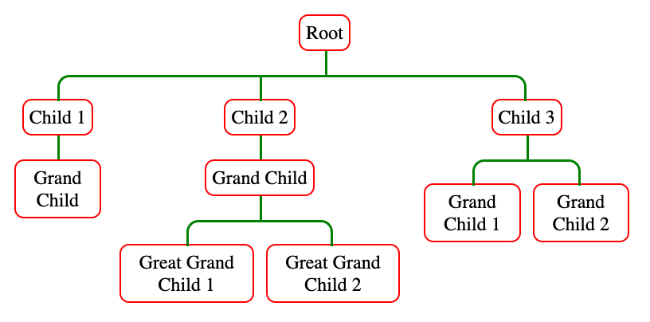

# react-organizational-chart

> Simple react hierarchy tree - any React children accepted for nodes


[](https://www.npmjs.com/package/react-organizational-chart)
[](https://github.com/prettier/prettier)

## Install

```bash
npm install --save react-organizational-chart
```

## Usage

```jsx
import React from 'react';
import { Tree, TreeNode } from 'react-organizational-chart';

const ExampleTree = () => (
  <Tree label={<div>Root</div>}>
    <TreeNode label={<div>Child 1</div>}>
      <TreeNode label={<div>Grand Child</div>} />
    </TreeNode>
  </Tree>
);
```

## Examples

### Styled tree



```jsx
const StyledNode = styled.div`
  padding: 5px;
  border-radius: 8px;
  display: inline-block;
  border: 1px solid red;
`;

const StyledTreeExample = () => (
  <Tree
    lineWidth={'2px'}
    lineColor={'green'}
    lineBorderRadius={'10px'}
    label={<StyledNode>Root</StyledNode>}
  >
    <TreeNode label={<StyledNode>Child 1</StyledNode>}>
      <TreeNode label={<StyledNode>Grand Child</StyledNode>} />
    </TreeNode>
    <TreeNode label={<StyledNode>Child 2</StyledNode>}>
      <TreeNode label={<StyledNode>Grand Child</StyledNode>}>
        <TreeNode label={<StyledNode>Great Grand Child 1</StyledNode>} />
        <TreeNode label={<StyledNode>Great Grand Child 2</StyledNode>} />
      </TreeNode>
    </TreeNode>
    <TreeNode label={<StyledNode>Child 3</StyledNode>}>
      <TreeNode label={<StyledNode>Grand Child 1</StyledNode>} />
      <TreeNode label={<StyledNode>Grand Child 2</StyledNode>} />
    </TreeNode>
  </Tree>
);
```

Interactive examples can be found [here](https://daniel-hauser.github.io/react-organizational-chart/)

## Components

### `Tree` - The root of the tree

Accepts the following props:

- **label:** _**\(required\)**_ Any react `Node`
- **children:** _**\(required\)**_ Any number of `<TreeNode>`
- **lineHeight:** _\(default 20px\)_ The height of the Path as a [css length](https://developer.mozilla.org/en-US/docs/Web/CSS/length)
- **lineWidth:** _\(default 1px\)_ The width of the Path as a [css length](https://developer.mozilla.org/en-US/docs/Web/CSS/length)
- **lineColor:** _\(default black\)_ The color of the Path as a [css color](https://developer.mozilla.org/en-US/docs/Web/CSS/color)
- **lineStyle:** _\(default solid\)_ The line style as a [css line-style](https://developer.mozilla.org/en-US/docs/Web/CSS/border-style#values)
- **lineBorderRadius:** _\(default 5px\)_ The border radius of the Path as a [css border-radius](https://developer.mozilla.org/en-US/docs/Web/CSS/border-radius)
- **nodePadding:** _\(default 5px\)_ The left and right padding of every `<TreeNode>` as a [css length](https://developer.mozilla.org/en-US/docs/Web/CSS/length)

### `TreeNode` - A node in the tree

- **label:** _**\(required\)**_ Any react `Node`
- **children:** _**\(required\)**_ Any number of `<TreeNode>`

## Motivation

I created `react-organizational-chart` because i could not find any other react organizational chart that supports react components as nodes.

## Alternatives

- [org-chart](https://www.npmjs.com/package/orgchart) is highly customizable but can't render React components as nodes.

## Development

Use Node.js 24 LTS and npm 11 for repository tooling. The published library still
supports React and React DOM **>=16.12.0**; development uses React 18, and packed
consumer checks cover React 16.12 and React 19.

```bash
npm ci                    # prepare builds the library
npm run format:check
npm run typecheck
npm test
npm run build-storybook
npx playwright install chromium
npm run test:browser
npm run test:package -- --browser
npm run size
```

`npm run storybook` starts the interactive examples on port 6006.
`npm run test:watch`, `npm start`, and `npm run prettier` provide test watching,
library rebuilds, and formatting. Formatting is enforced in CI rather than by a
Git hook. Browser tests reuse Storybook examples, check connector geometry and
uneven labels, and compare committed screenshot baselines. DOM snapshots retain
readable Emotion CSS with stable class names. Both are reviewable regression
baselines, not proof of all browser coverage. Playwright manages and stops its
preview server.

Storybook uses JavaScript CSF stories/configuration because its current 10.6
TypeScript declarations fail strict checking. This keeps the security-patched
release without suppressing library type errors; stories are build/browser
validated. TypeScript 6 retains the compiler API required by Storybook's docgen
tooling, unlike TypeScript 7. React 18 development types remain aligned with
Storybook/MDX. These are tooling constraints, not narrower consumer support;
no `skipLibCheck` is used.

A scoped npm override uses docgen plugin 0.9.1, which replaces its vulnerable
glob/minimatch chain with tinyglobby and supports Vite 8/TypeScript 6. Remove the
override when Storybook updates its own compatible dependency range.

### Reviewing snapshots

Review DOM/CSS and screenshot changes in PRs; update baselines only after
checking that the rendered changes are intentional:

```bash
npm test -- --update
```

The five PNG baselines in `tests/browser/__screenshots__` target Linux/amd64,
Playwright 1.65.0's Chromium, and the immutable official Noble image used by CI.
Fonts, OS, browser versions, and rendering modes can change pixels. Generate
and verify screenshots in that same image, rather than updating from another
platform. With Linux/amd64 dependencies and Storybook already built:

```bash
docker run --rm --init --ipc=host --user "$(id -u):$(id -g)" \
  -e npm_config_cache=/work/node_modules/.cache/npm \
  -v "$PWD:/work" -w /work \
  mcr.microsoft.com/playwright@sha256:bc4fbb329a25287ed23e9216c97063646abdd1bf2da669a9895fa3e2078b2302 \
  npm run test:browser -- --update-snapshots=all
```

Omit `--update-snapshots` to verify comparisons without changing baselines.
On other host platforms, install dependencies and build Storybook inside the
image too. Keep the pinned image and Playwright package versions aligned.
CI never updates snapshots and retains expected/actual/diff images plus an HTML
report on failures. Comparisons use zero pixel tolerance; no labels or connectors
are masked.

### Package outputs

tsdown emits CommonJS, ESM, declarations, and a standalone UMD browser build.
The existing `dist/index.js`, `dist/index.module.js`, and `dist/index.umd.js`
entry paths remain available. Conditional exports add native ESM via
`dist/index.module.mjs`, with separate ESM/CJS declarations. React and Emotion
remain external in CJS/ESM. The UMD build bundles Emotion and retains the
historical `reactOrganizationalChart` global (provide React as `window.react`).
Externalizing Emotion also avoids the old browser-only bundled Emotion import
failure in Node; it does not implement SSR style extraction or hydration.

`test:package` installs an actual local tarball into isolated consumers, checks
both module systems and types, and cleans up afterward. `--browser` additionally
checks the packed UMD in Chromium. Bundle-size checks report raw/gzip bytes in
the PR workflow summary and enforce small gzip budgets (3 KB CJS/ESM, 15 KB UMD);
they measure library artifacts, not total application dependencies.

### CI, previews, and releases

Pushes and PRs run formatting, strict types, unit tests, packed consumer checks,
and Storybook/browser builds on Node 24. GitHub Actions are pinned to release
SHAs; Dependabot groups weekly npm and action updates.

Master pushes continue deploying documentation to `gh-pages`. Same-repository
PRs deploy to `pull/<number>` and update a preview comment after a successful
build. Fork and Dependabot PRs still build and upload preview artifacts, but skip
write-permission deployment/comments. No `pull_request_target` code execution is
used. Documentation deployments preserve existing PR previews.

Publishing still runs on master pushes and skips an unchanged npm version.
It uses the existing `NPM_TOKEN` secret with npm-publish v4; no token value is
stored in the repository. Switching to npm trusted publishing requires a package
owner to configure this repository and `npmpublish.yml` in npm, then explicitly
enable `id-token: write` and remove the publish token. That external setup is not
assumed here. Required branch checks and Pages/npm account settings must be
configured by maintainers; local validation does not verify hosted workflows.

## License

MIT © [daniel-hauser](https://github.com/daniel-hauser)
